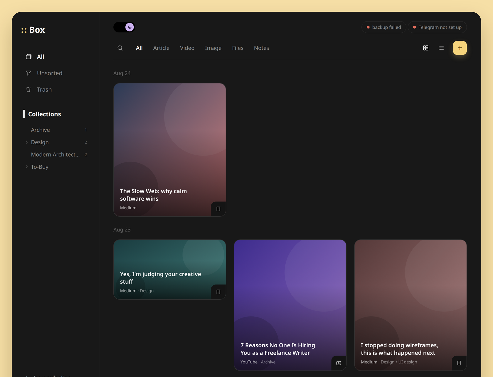

# 📦 Box

**Save anything from your phone by sharing it to a Telegram chat.** Box runs on
your own computer, syncs those messages — even ones sent while the computer was
off — and organizes them into collections with a visual card UI.

[](https://github.com/calmcodelabs/box/actions/workflows/ci.yml)
[](LICENSE)
[](https://www.python.org/downloads/)



<sub>Fresh install with demo data — the status pills go green once Telegram and
backups are connected.</sub>

## How it works

1. On your phone, share any post / article / video / photo / file to your
   **Box** chat on Telegram.
2. Send the destination as the **next message** in the same chat:

   ```
   To-Buy // Kitchen
   ```

   That's `Collection // Subcategory` (the `// Subcategory` part is optional).
   Collections are created automatically if they don't exist yet.
   You can also **reply** to any earlier shared message with a collection name.
3. If you don't send a collection message, the item lands in **Unsorted** and
   you can move it from the web UI later.

Because Box logs in as *you* (via Telegram's official API), it can read the
chat's full history — so anything shared while your computer was offline is
picked up the next time Box starts. It also fetches link previews (title,
source, cover image) for everything you save.

Everything stays on your machine: a SQLite database plus downloaded media in
`data/`. No accounts, no server, nothing leaves your computer except the
optional backup to your own Google Drive.

## Setup

**1. Install** (Python 3.11 or newer):

```bash
git clone https://github.com/calmcodelabs/box.git
cd box
python3 -m venv .venv
.venv/bin/pip install -r requirements.txt
cp config.example.json config.json
```

**2. Get Telegram API keys** (free, takes 2 minutes):
go to <https://my.telegram.org> → *API development tools* → create an app.
Copy the `api_id` and `api_hash` into your `config.json`.

**3. Create the chat**: in Telegram, create a new **private channel** named
`Box` (just you in it — it becomes your personal inbox and is easy to share
to). Alternatively, set `"chat": "me"` in config.json to use your
*Saved Messages* instead.

**4. Log in** (asks for your phone number + the code Telegram sends you):

```bash
.venv/bin/python -m box login
```

## Run it

```bash
./run.sh
```

Then open <http://localhost:8750>. The pill in the top-right shows sync status.
Box re-checks the chat every ~90 seconds and also receives new messages
instantly while online.

## Try it without Telegram

Seed sample data to explore the UI first:

```bash
.venv/bin/python -m box demo
```

(Reset later with `rm data/box.db data/media/demo_*.svg`.)

## Daily Google Drive backup

Box backs itself up once a day while it's running (and catches up on start if
a day was missed): a dated, consistent snapshot of the database plus a
portable JSON export land in `data/backups/`, and the whole data folder
(snapshots, photos, files, link previews, config) is synced to your Drive
with [rclone](https://rclone.org/install/). The raw Telegram chat itself
already lives on Telegram's cloud, so between the two, a dead computer costs
you nothing.

**One-time setup** (authorizes rclone with your Google account in a browser):

```bash
rclone config
```

Choose: `n` (new remote) → name it `gdrive` → storage type `drive` →
leave client id/secret empty → scope `1` (full access) or `3`
(access to files created by rclone only — enough for Box) → accept defaults →
say **yes** to auto config, and finish the Google login it opens in your
browser.

That's it — the next backup goes to the `Box-Backup` folder in your Drive.
Check the *backup* pill in the top-right of the UI (click it to back up
immediately), or run one manually:

```bash
.venv/bin/python -m box backup
```

Settings live under `"backup"` in config.json: `remote`, `folder`,
`interval_hours`, `keep_snapshots` (dated snapshots retained), `enabled`.
Set `"enabled": false` to turn backups off entirely.

**Restoring on a fresh machine**: clone this project, then download the
`Box-Backup/data` folder from Drive into `data/`, and rename the newest
`data/backups/box-YYYY-MM-DD.db` to `data/box.db`. Run `python -m box login`
again (the Telegram session is intentionally never uploaded) and start Box.

## Project layout

```
box/
  __main__.py    CLI entry point — run | login | demo | backup
  server.py      FastAPI app and JSON API
  sync.py        Telegram client: history catch-up + live updates
  metadata.py    link previews (title, source, cover image)
  db.py          SQLite schema and queries
  backup.py      daily snapshot + rclone upload
  login.py       one-time Telegram sign-in
  config.py      config loading and defaults
  demo.py        sample data seeder
static/          single-page UI — plain HTML/CSS/JS, no build step
data/            local state: database, media, backups (never committed)
```

## Notes

- `config.json` options: `chat` (chat title or `"me"`), `port`,
  `max_file_mb` (largest shared file to download), and the `backup` block.
  It's gitignored — `config.example.json` is the template.
- Trash keeps items until you delete them permanently from the Trash view.
- Never share `data/box_session.session` — it grants access to your Telegram
  account. Backups deliberately exclude it.

## License

[MIT](LICENSE) © 2026 Shashwat Gupta
